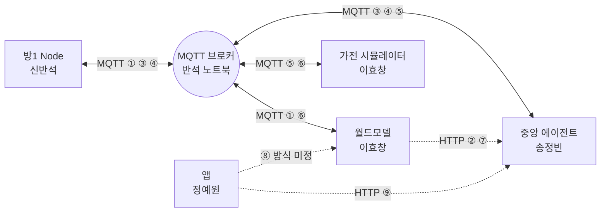

# EYEAR 연결 구조

2026-11-19 각 레포 코드 기준, 11-23 갱신 (신반석 정리). 실제 Node, 월드모델, 중앙 에이전트, 가전, 앱이 무엇으로 이어지는지와 지금 각 구간이 준비됐는지 적었다.
MQTT는 모두 반석 노트북의 브로커를 거친다. 월드모델에서 중앙으로는 HTTP다.
같은 내용을 보기 좋게 만든 페이지: [connections.html](connections.html) (내려받아 브라우저로 열기)

실선 = MQTT (브로커를 거침), 점선 = HTTP 또는 미정. 숫자는 아래 표의 흐름 번호.

## 흐름별 내용과 준비 상태

| # | 무엇을 | 보내는 쪽 → 받는 쪽 | 방식 · 토픽/경로 | 상태 |
|---|---|---|---|---|
| ① | 방 상태 (1초마다 + 바뀔 때), Node 켜짐·꺼짐 | Node → 월드모델 | MQTT `eyear/v0/{room_id}/state`, `eyear/v0/{room_id}/status` | ❌ 월드모델 쪽 필요 |
| ② | 집 전체 상태 (WorldSnapshot 2.0) | 월드모델 → 중앙 | HTTP `POST /v2/world/sessions`, `POST /v2/world/snapshots` | ❌ 월드모델 쪽 필요 |
| ③ | 말할 문장 ("A님, 주무실 건가요?") | 중앙 → Node | MQTT `eyear/v0/{room_id}/speak` | ✅ 준비됨 |
| ④ | 질문에 대한 대답, "하이 엘지" 뒤 명령 (텍스트만) | Node → 중앙 | MQTT `eyear/v0/{room_id}/voice/reply`, `eyear/v0/{room_id}/voice/command` | ✅ 준비됨 |
| ⑤ | 가전 명령 | 중앙 → 가전 | MQTT `eyear/v0/device/{device_id}/command` | ⚠️ 확인 필요 |
| ⑥ | 가전 상태·실행 결과 | 가전 → 월드모델 | MQTT `eyear/v0/device/{device_id}/state`, `.../result` | ⚠️ 확인 필요 |
| ⑦ | 가전 실행 결과 전달 | 월드모델 → 중앙 | HTTP `POST /v2/world/device-results` | ❌ 월드모델 쪽 필요 |
| ⑧ | 사람별 선호 (예: A 24°C, B 26°C) | 앱 → 월드모델 | 미정 | ⚠️ 정해야 함 |
| ⑨ | 운영자 제어 (일시정지·재개·초기화) | 앱 → 중앙 | HTTP `POST /v1/control` | ⚠️ 확인 필요 |

- ① 월드모델 파서가 0.2를 받는다 (eyear-worldmodel `4b6cd25`, 실제 Node 메시지로 방1 상태가 따라가는 것 확인).
  남은 것: 월드모델에 MQTT 구독 코드가 아직 없다. status 토픽은 아직 안 받는다.
- ②⑦ 중앙은 받는 경로가 있다. 월드모델에 보내는 코드가 아직 없다.
- ③④ 형식이 서로 맞는 것을 코드로 확인했다 (중앙은 Node의 0.x를 모두 받고, Node는 중앙의 0.1을 받음). 실제로 이어서 돌려 본 적은 없다.
- ⑤⑥ 중앙은 보내는 코드가 있다. 시뮬레이터는 지금 브라우저 안 버스로 같은 토픽 규칙을 쓴다 (`sim/README.md`). 실제 브로커에 붙는지 확인 필요.
- ⑧⑨ 앱 쪽 연결 방식은 코드에서 찾지 못했다. 월드모델 쪽 A 프로필은 MEMBER_D로 맞춤 (4b6cd25).

## 처음 연결 테스트 전에 할 일

**신반석 (Node · 브로커)**
- 브로커를 같은 와이파이에서 접속할 수 있게 열고 아이디·비밀번호 설정 (지금은 반석 노트북 안에서만 접속 가능)
- 브로커 주소와 접속 정보 공유 (이 레포에는 비밀번호를 쓰지 않음, RULES.md)
- 시연 공간에서 Node 위치 고정 (옮기면 레이더 위치를 다시 재야 함)

**이효창 (월드모델)**
- 브로커에서 `eyear/v0/+/state` 구독 → NodeHub에 넣기
- 중앙으로 HTTP 보내기 (②, ⑦)

**송정빈 (중앙)**
- 중앙 서버를 브로커 주소로 실행 (MQTT 구독·발행 코드는 이미 있음)
- 월드모델이 접속할 HTTP 주소 공유 (기본 포트 8765)

**정예원 (앱)**
- 선호 설정을 월드모델에 넘기는 방식 정하기 (⑧)
- 운영자 제어를 `POST /v1/control`로 보내는지 확인 (⑨)

근거: eyear-node (schema 0.2), eyear-worldmodel `6e33647`, eyear-orchestrator (2026-11-19 커밋), 시뮬레이터 `sim/README.md`.
틀린 곳이 있으면 이 파일을 고치거나 banseok inbox로 알려 주세요.
